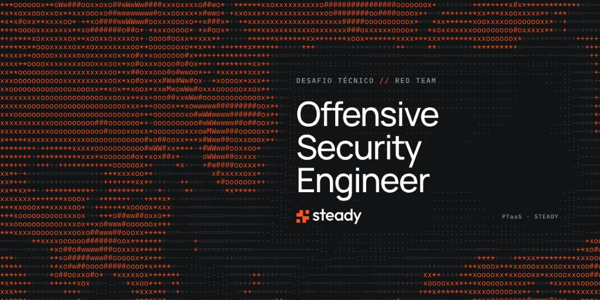

# Desafio — Offensive Security Engineer

Repositório do desafio técnico da vaga de Offensive Security Engineer na Hous3.

O desafio avalia três coisas:

1. **Como a pessoa conduz o pentest.** Por onde entra, o que mapeia, o que aprofunda e quando para. A técnica sustenta essa condução: web, API e as ferramentas do teste.
2. **A linha de raciocínio.** Cada conclusão nasce de uma hipótese, de um teste e de uma evidência. O que foi descartado faz parte da avaliação.
3. **Como entrega o relatório.** O texto serve para priorizar e para corrigir: impacto, severidade coerente com esse impacto, correção específica e evidência sem segredo.

Achar muita coisa não substitui nenhuma das três. Um achado grave omitido no relatório, ou um relatório que a nota não sustenta, pesa contra.

## Terreno técnico

As habilidades da vaga são o terreno do teste, não uma lista para marcar.

| Terreno | Onde aparece na condução |
| --- | --- |
| Web/API | OWASP Top 10, IDOR, XSS, injeção, autenticação e gestão de sessão |
| Ferramentas | Burp Suite, nmap, ffuf ou gobuster e nuclei, cada um respondendo uma pergunta do pentest |

O detalhe de cada terreno está na pasta correspondente. A nota está em [`docs/rubrica.md`](docs/rubrica.md). Quem corrige a entrega segue [`docs/avaliacao.md`](docs/avaliacao.md).

## Como o desafio funciona

1. Ler o [briefing](docs/briefing.md) e as [regras de engajamento](docs/regras-de-engajamento.md).
2. Confirmar o alvo, a janela e o canal de dúvida em [`docs/escopo.md`](docs/escopo.md). Fora dessa lista, não há teste.
3. Conduzir o pentest só no laboratório publicado.
4. Entregar duas peças:
   - [`entregas/relatorio.md`](entregas/relatorio.md), a partir de [`docs/template-relatorio.md`](docs/template-relatorio.md) — o relatório como iria para o cliente.
   - [`entregas/notas.md`](entregas/notas.md), a partir de [`docs/template-notas.md`](docs/template-notas.md) — o caderno do pentest, com a ordem das decisões.
5. Evidência redactada em `entregas/evidencias/`.

Prova de impacto é mínima: o suficiente para mostrar o controle quebrado. Dado real de cliente, credencial ou dump não entra no repositório.

## Layout

```
docs/           briefing, regras, escopo, rubrica, avaliação e templates
web-api/        terreno de aplicação e API
ferramentas/    terreno das ferramentas
entregas/       relatório, notas de raciocínio e evidências
```

## O que não entra no git

Sessão do Burp, arquivo `.har` com cookie, `.env`, chave, token, dump de base e saída bruta de scan com dado sensível. O [`.gitignore`](.gitignore) já cobre o caso comum. Evidência no relatório mostra o controle quebrado e omite segredo e dado pessoal.
